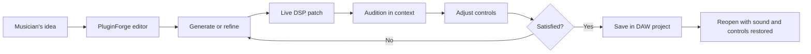
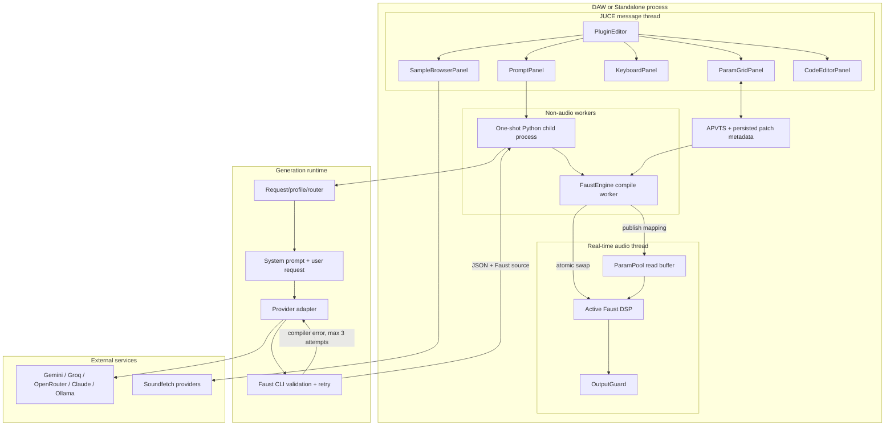
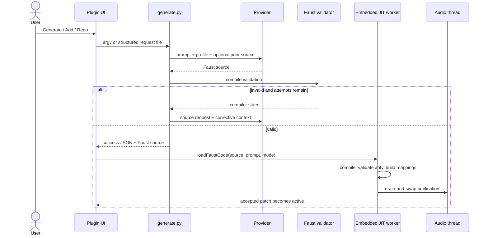
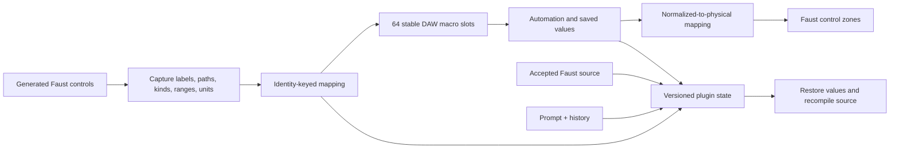
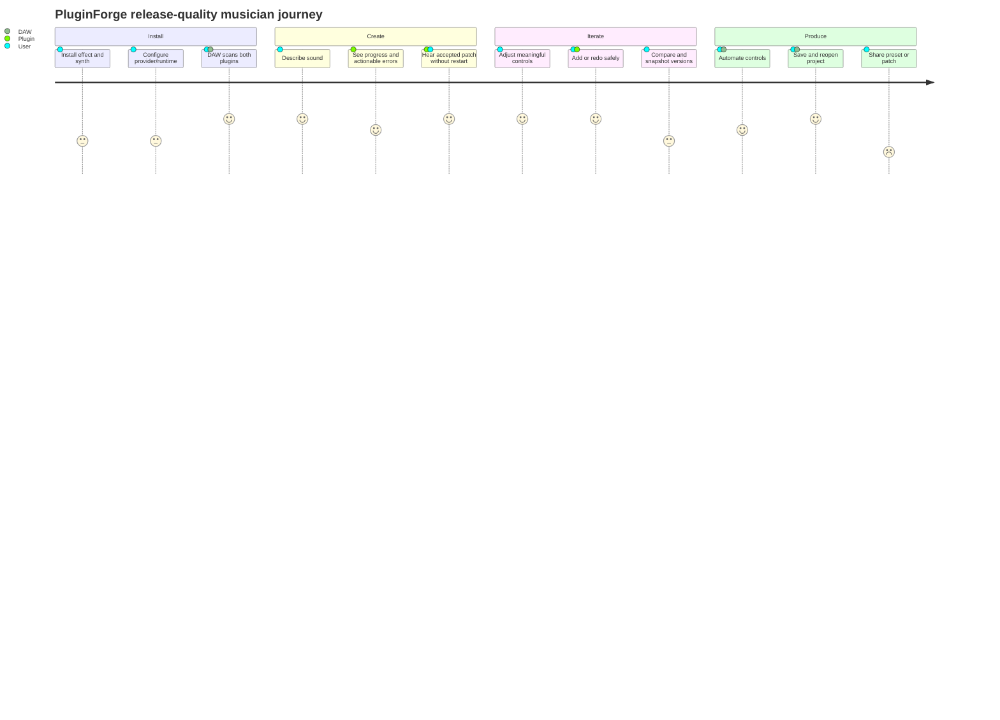
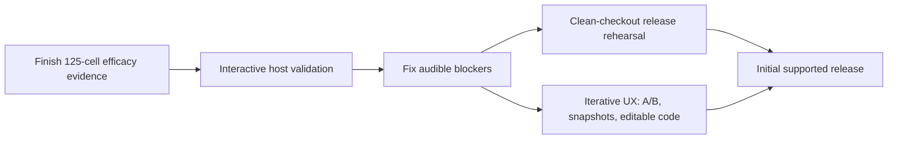

# PluginForge / Incant Audio — Product Architecture and Development Plan

**Artifact date:** 2026-08-17  
**Architecture baseline:** `origin/main` at `8c0d724`  
**Audience:** product owner, audio/plugin engineers, AI-system engineers, and future contributors

## Executive view

PluginForge is not primarily a prompt benchmark. It is a **runtime audio-plugin platform**
that lets a musician describe an effect or instrument, turns that description into Faust DSP,
loads the DSP without restarting the plugin, exposes its controls to the DAW, and preserves the
result with the project.

It ships as two products built from one core:

| Plugin | Input | Output | Musician uses it for |
|---|---|---|---|
| **PluginForge Host** | Stereo audio | Processed stereo audio | Filters, distortion, dynamics, modulation, delay, reverb, and effect chains |
| **PluginForge Synth** | MIDI / audition keyboard | Generated stereo audio | Synthesizers, drums, drones, and playable generated instruments |

The long-term product is an iterative instrument-building environment inside a familiar plugin:
generate, audition, refine, compare, automate, save, reopen, and eventually share.

## The user workflow

### 1. Install and configure

The user installs the effect and/or synth VST3 bundle, installs the Python generation runtime,
and provides an LLM provider configuration. The DAW process must be able to locate
`llm/generate.py`; packaged installs use `PLUGINFORGE_LLM_SCRIPT` to make that location explicit.

Current distribution reality is **Linux x86-64 VST3 and Standalone**. AU, Windows, signing,
notarization, and a system-wide installer are not implemented and must not be advertised yet.

### 2. Choose the right plugin

- Insert **PluginForge Host** on an audio track or bus to generate an effect.
- Insert **PluginForge Synth** on an instrument track to generate a MIDI-playable instrument.
- The Standalone synth can be auditioned with MIDI, the on-screen keyboard, or mapped QWERTY keys.

This effect/instrument split is deliberate. VST3 bus layout, MIDI capability, and instrument
metadata are fixed when the host scans the plugin; they cannot safely change after generation.

### 3. Describe the sound

The editor gives the musician a prompt field plus an explicit generation family/style selection.
The user can start fresh or refine the current patch:

- **New/Fresh:** generate a replacement from the new prompt without carrying old source.
- **Add:** make a surgical change while preserving the current Faust program.
- **Redo:** use the current patch as context but allow a structural rewrite.

Prompt history is stored and can be recalled. Add/Redo becomes available only when a valid prior
patch exists.

### 4. Generate without blocking audio

The UI starts a one-shot Python child process. Generation, provider waits, Faust CLI validation,
and corrective retries happen away from the audio thread. The child returns one structured JSON
result. Failure is shown in the editor instead of silently replacing the working patch.

### 5. Compile and activate the patch

The C++ host sends validated Faust source to the embedded libfaust/LLVM engine. A dedicated compile
worker builds the DSP, validates its channel/control contract, prepares its parameter mapping, and
atomically replaces the active DSP only after the audio thread has drained its current section.

The previous valid patch remains the source of truth until the new compile succeeds.

### 6. Audition and shape the result

The generated patch appears as titled parameter sections in the editor. Faust sliders, buttons,
checkboxes, units, ranges, and scaling metadata determine the control presentation. The musician
can play the synth immediately or listen to an effect in the track context, then adjust controls
while audio continues.

The code panel provides an advanced, read-only view of the generated Faust source, copy support,
and compiler-error line highlighting. The no-code workflow remains the default.

### 7. Automate and save

The DAW always sees 64 stable parameter identities (`macro_0` through `macro_63`). A generated
patch maps its named Faust controls onto those stable slots. This allows live patch replacement
without invalidating the DAW's parameter registry or automation IDs.

The plugin state stores the accepted Faust source, originating prompt, prompt history, parameter
values, and mapping metadata. Reopening the DAW project recompiles the stored source and restores
the controls; native machine code is never serialized.

## Runtime architecture

### Process and thread boundaries

| Boundary | What crosses it | Why it exists |
|---|---|---|
| Editor → Python child | Prompt or structured request file | Keeps Python/provider failures outside the plugin process and avoids a permanent daemon |
| Python → LLM provider | System prompt, user prompt, optional prior source | Provider-neutral generation with free-by-default policy |
| Python → editor | One JSON result containing success, Faust source, error, attempts, and refinement flags | One explicit IPC contract with actionable failures |
| Message/compile side → audio thread | Atomically published DSP pointer, arity, voice controls, and parameter-map buffer | Prevents allocation, locks, I/O, and partial state on the real-time thread |
| Plugin → DAW state | Stable parameters plus serialized source/prompt/mapping metadata | Makes generated patches survive project save/reopen |

## Generation subsystem in context

The AI subsystem is a compiler front-end for the plugin, not the product by itself.

Safety and truth rules:

1. Compiler success is necessary but not sufficient; offline rendering and listening catch
   silent or semantically wrong DSP.
2. A failed generation or JIT compile never replaces the last accepted source-of-record.
3. Rate limits and timeouts return structured failures; benchmark runs checkpoint rather than
   sleeping indefinitely.
4. The audio thread performs no generation, compilation, allocation, logging, file access, or
   provider work.

## Stable parameter and persistence model

This design favors session and automation compatibility over perfectly dynamic DAW parameter
lists. The plugin UI can show meaningful titles and physical values, but generic DAW automation
views may still expose stable macro slots. Changing that contract requires an explicit compatibility
decision because existing sessions and automation lanes must remain recoverable.

## Development plan: the whole plugin

### Phase 1 — Prove the core instrument loop

**Status: substantially complete.**

Delivered:

- Separate effect and synth targets.
- Provider-neutral natural-language generation.
- Faust validation and corrective retry.
- Embedded LLVM JIT and real-time-safe DSP replacement.
- Dynamic control capture and 64-slot mapping.
- State persistence and restore-time recompilation.
- Fresh/Add/Redo workflows, prompt history, code inspection, keyboard auditioning, and sectioned UI.

User outcome: a musician can create and iterate on a live effect or instrument without rebuilding
C++ or restarting the plugin.

### Phase 2 — Prove it in a musician's real environment

**Status: partly complete; interactive host session remains the primary gap.**

Completed evidence:

- Standalone effects listening pass.
- Known-provenance VST3 builds.
- Strict `pluginval` success for effect and synth.
- Independent Carla discovery/instantiation for both targets.

Outstanding:

- Install/enable JACK compatibility, preferably `pipewire-jack` on this machine.
- Load both plugins in Carla's interactive Rack/Patchbay.
- Generate while hosted; play MIDI; process real audio; move controls; automate; save/reopen;
  close the editor and host; listen for silence, discontinuity, runaway output, or stuck notes.

User outcome: confidence that the advertised workflow works in a real host, not only in harnesses.

### Phase 3 — Close audible and interaction defects

**Status: active product-hardening backlog.**

Priority order:

1. Isolate and fix the silent generated noise gate (PF-032).
2. Reproduce and fix incorrect Faust envelope time units (PF-045).
3. Measure and reduce remaining invalid-generation families (PF-024).
4. Make incompatible Ollama context settings fail before generation (PF-043).
5. Complete OS-keypress-to-note verification.
6. Define long-release instrument-tail behavior.
7. Decide how stable DAW macro slots should be presented in generic host automation views.
8. Finish or explicitly defer meter rendering and standalone-project export.

User outcome: fewer “successful” patches that are silent, wrong, truncated, unplayable, or confusing.

### Phase 4 — Make builds installable and supportable

**Status: packaging exists; release proof remains incomplete.**

Required work:

- Reproduce Release builds from a clean checkout using only documented dependencies.
- Pin supported JUCE, Faust/libfaust, LLVM, compiler, and Python ranges.
- Choose the supported platform matrix. Default recommendation: claim Linux x86-64 VST3 and
  Standalone only until another platform has CI plus host evidence.
- Validate the staged archive, installer, runtime discovery, licenses, versions, and hashes.
- Define a release gate: CI, full/audio ladders, pluginval, interactive host, state restoration,
  automation, MIDI, tail behavior, teardown, and a human listening pass.

User outcome: installation becomes repeatable and supportable on a clean machine.

### Phase 5 — Turn generation into an iterative creative workspace

**Status: foundations delivered; higher-level workflows pending.**

Planned capabilities:

- A/B switching between the two most recent accepted patches.
- Named snapshots containing source, prompt, mappings, and values.
- Editable Faust source with Compile using the same validation/JIT path.
- Preset browser and versioned `.pforge` import/export.
- Provider/model selection UI after provider policy is settled.
- Preset audition phrases, followed later by a piano-roll editor if transport/clock semantics are
  explicitly designed.

User outcome: the plugin evolves from “generate a result” to “develop a reusable sound.”

### Phase 6 — Expand only after the core contract is proven

**Status: deferred.**

Possible later work includes additional plugin formats/platforms, deeper polyphony and MIDI
expression, richer meter widgets, sharing/community workflows, and exported standalone plugin
projects. These should not precede reliable audio, host behavior, session compatibility, and
distribution evidence.

## Acceptance journey from a user's perspective

The numbers above describe target experience, not measured satisfaction. Lower-scored steps are
where product development is incomplete today.

## Definition of release-ready

PluginForge is ready for an initial supported release when all of the following are evidenced:

1. A clean machine can build or install the documented artifact.
2. Both effect and synth pass strict plugin validation and load interactively in a supported host.
3. Generation works from the packaged runtime path with at least one supported provider.
4. Effect audio and synth MIDI are audible and stable across generation, refinement, automation,
   save/reopen, sample-rate changes, and teardown.
5. The offline audio corpus has no unexplained silence, NaN, runaway gain, arity, or tail failures.
6. All public compatibility choices—platforms, parameter presentation, state schema, provider
   policy, and dependencies—are documented and versioned.
7. Objective validation and human listening evidence are both recorded; neither substitutes for
   the other.

## Immediate critical path

Prompt efficacy remains useful, but it is only one input to the release decision. The critical
path is a balanced product path: **real host behavior + audible correctness + recoverable state +
reproducible distribution + an understandable creative workflow**.

## Sources of architectural truth

- [`README.md`](../README.md) — product capabilities and build entry point.
- [`INTERFACE.md`](../INTERFACE.md) — C++/Python subprocess contract.
- [`host/Source/CONTRACT.md`](../host/Source/CONTRACT.md) — real-time audio closure and swap protocol.
- [`docs/decisions.md`](../docs/decisions.md) — accepted architectural decisions.
- [`docs/BUGS.md`](../docs/BUGS.md) — durable defect registry.
- [`STATUS.md`](../STATUS.md) — live evidence and current priorities.
- [`PLUGIN_HEALTH_PLAN.md`](../PLUGIN_HEALTH_PLAN.md) — release and product-health work queue.
- [`docs/ux_roadmap.md`](../docs/ux_roadmap.md) — iterative authoring roadmap.
- [`docs/distribution.md`](../docs/distribution.md) — current package and install contract.
